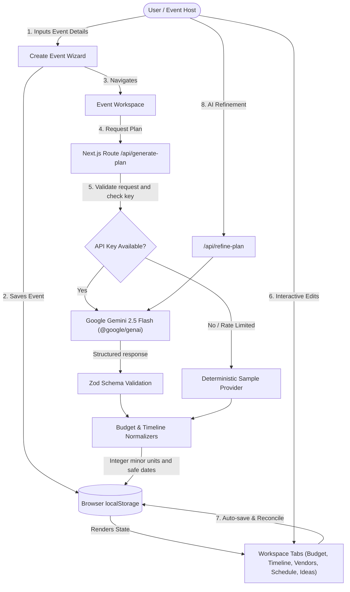

# Gatherly AI

**Tagline:** Every celebration, thoughtfully planned.

Gatherly AI is a GenAI-powered celebration and event planning assistant built for the hackathon challenge. It empowers organizers, couples, families, and community leaders to turn celebration concepts into actionable, stress-free plans with numerically reconciled budgets, date-anchored timelines, supplier guidance, chronological run sheets, and personalized inspiration.

---

## Table of Contents
1. [Problem Statement & Vision](#1-problem-statement--vision)
2. [Target Users](#2-target-users)
3. [Key Features & What Makes Gatherly AI Unique](#3-key-features--what-makes-gatherly-ai-unique)
4. [Technology Stack](#4-technology-stack)
5. [Architecture & Data Flow](#5-architecture--data-flow)
6. [Quick Start & Local Installation](#6-quick-start--local-installation)
7. [Configuring Google Gemini GenAI](#7-configuring-google-gemini-genai)
8. [Deterministic Demo Mode](#8-deterministic-demo-mode)
9. [Running Tests, Linting & Production Build](#9-running-tests-linting--production-build)
10. [Deployment Guide (Vercel)](#10-deployment-guide-vercel)
11. [Security, Reliability & Privacy](#11-security-reliability--privacy)
12. [Known Limitations](#12-known-limitations)
13. [Assumptions](#13-assumptions)
14. [Hackathon Submission Checklist](#14-hackathon-submission-checklist)

---

## 1. Problem Statement & Vision

**Official Brief:**
> "Celebration & Event Planner: Create a GenAI-powered planning assistant that helps users organize weddings, birthdays, and community events with budgets, timelines, vendor checklists, and personalized ideas."

**Chosen challenge vertical:** Celebration & Event Planner.

**Our Solution:**
Planning significant personal and community celebrations usually collapses into fragmented spreadsheets, unverified estimates, and panic. Generic LLMs merely generate walls of text that lack numerical consistency and calendar awareness.

Gatherly AI pairs **Google Gemini GenAI** with **deterministic application logic**:
- **Generative AI** generates tailored concepts, structured categories, vendor criteria, and personalized ideas.
- **Deterministic Math Engines** compute integer minor currency units (paise/cents) to ensure zero rounding error, enforce contingency buffers, and flag overspending.
- **Calendar Logic** anchors tasks to real event dates with timezone-safe UTC math and accelerated short-notice scheduling.

---

## 2. Target Users

1. **Couples & Wedding Hosts:** Planning multi-ceremony weddings, engagement dinners, and receptions with multi-vendor coordination and dietary accommodations.
2. **Families Celebrating Milestones:** Organizing milestone birthdays (1st, 18th, 30th, 50th, 80th), golden anniversaries, and family reunions.
3. **Community & Non-profit Organizers:** Organizing neighborhood socials, charity fundraisers, festival banquets, and cultural celebrations.

---

## 3. Key Features & What Makes Gatherly AI Unique

### A. Central Dashboard & Multi-Event Isolation
- Overview of all active celebrations with aggregated budget metrics and overall task progress.
- Clean event cards with data-driven readiness score badges and category tags.
- Safe browser-local storage with support for creating, updating, and deleting multiple independent events.

### B. 3-Step Create Event Wizard
- **Step 1 (Basics):** Event name, type (Wedding, Birthday, Anniversary, Community, Fundraiser, Other), date, duration, location, guest count.
- **Step 2 (Budget & Style):** Target budget defaulting to Indian Rupees (₹) with multi-currency support, theme/aesthetic, venue environment (indoor, outdoor, mixed), and desired atmosphere.
- **Step 3 (Personalization):** Priority selection (Food, Photography, Decor, Music, Accessibility, Sustainability, Cost discipline), dietary accommodations, accessibility needs, and traditions.

### C. Smart Budget Guardian
- Reconciles category allocations with target budget using integer minor currency units (`totalAllocated + unallocated === totalBudget`).
- Editable category planned allocations and actual invoice spending.
- Visual proportional distribution stack bar.
- Automatic alerts for overspending, over-allocation, or contingency reserves falling below the recommended 5–10% safety cushion.

### D. Date-Aware Timeline & Task Manager
- Milestones anchored to celebration dates with realistic planning stages (Initial Planning, Early Preparations, 2–4 Weeks Before, Final Week, Day Before, Event Day, Post-Event).
- Adaptive schedule acceleration for short-notice events (prevents setting past due dates).
- Interactive completion checkboxes that instantly update overall progress.
- Status and priority filtering with custom task creation and editing.

### E. Vendor Checklist Guidance
- Event-specific requirements outlining what you need, why it matters, target booking deadlines, and priorities.
- Status management: *Needed*, *Contacted*, *Confirmed*, or *Not Required*.
- Supplier notes for recording personal phone numbers, quotes, or deposit records.
- Explicitly avoids fabricating fake directory listings or fake vendor quotes.

### F. Chronological Event-Day Run Sheet
- Ordered timetable from morning load-in through to evening wrap-up.
- Activity start and end times, descriptions, responsible leads, and staging cues.
- Printer-friendly layout suitable for sharing with emcees, caterers, and family coordinators.

### G. AI Refinement Studio
- Real-time plan modifications dispatching structured prompts to the AI backend.
- Presets: *More Budget-Friendly*, *Elevate Elegance*, *Eco-Friendly & Zero-Waste*, *Strengthen Rain Contingency*, *Child-Friendly*, and *Custom Prompts*.
- Carries matching task completion, vendor status and notes, recorded spending, and run-sheet notes across live refinements.
- Deterministic demo refinements apply explicit preset rules to the current plan and retain user progress; unsupported free-form requests are recorded as a review task instead of being described as understood.

### H. Data-Driven Preparation Readiness Score
- Transparent 0–100% calculation based on:
  - 35% Task Completion (overall + high-priority tasks)
  - 25% Vendor Confirmations
  - 20% Schedule Run Sheet Completeness
  - 20% Budget Integrity & Contingency Buffer

### I. Export & Sharing
- **1-Click Print Run Sheet:** Clean `@media print` layout that automatically hides navbars and buttons.
- **Download JSON Backup:** Export complete event plan data for offline backup or migration.
- **Copy Plain-Text Summary:** Formatted plain-text digest ready to paste into WhatsApp, email, or notes.

---

## 4. Technology Stack

- **Framework:** Next.js 16.4 (App Router with partial prerendering & cacheComponents)
- **Language:** TypeScript 5 (Strict type checking, zero `any` in critical logic)
- **Styling:** Tailwind CSS v4 with custom warm planning studio theme tokens
- **Icons:** Lucide React
- **GenAI SDK:** Google's official `@google/genai` SDK (`gemini-2.5-flash`)
- **Validation:** Zod 4 for strict server-side request/response schema validation
- **Persistence:** Browser `localStorage`; event data is sent to the app API when a user requests AI generation or refinement
- **Test Runner:** Vitest 5 with `@testing-library/react` and `jsdom`

---

## 5. Architecture & Data Flow



### Project Structure

- `app/` contains the Next.js routes, page composition, and server API handlers.
- `components/` contains the dashboard, event workspace, and focused event-creation steps.
- `lib/` contains domain rules, shared validation, persistence, AI providers, and budget/timeline calculations.
- `tests/` contains unit and integration coverage; `tests/e2e/` contains browser-level regression scenarios.
- `docs/` contains the demo script, deployment notes, and the latest local verification record.

---

## 6. Quick Start & Local Installation

### Prerequisites
- Node.js `v20.x` or later (tested on Node v26)
- npm `v10.x` or later

### Installation Steps

1. **Clone the repository:**
   ```bash
   git clone https://github.com/mudassar-quraishi/GatherlyAI.git
   cd GatherlyAI
   ```

2. **Install dependencies:**
   ```bash
   npm install
   ```

3. **Configure Environment Variables (Optional for Live AI):**
   ```bash
   cp .env.example .env.local
   ```
   Edit `.env.local` with your Google Gemini API key:
   ```env
   GEMINI_API_KEY=your_gemini_api_key_here
   GEMINI_MODEL=gemini-2.5-flash

   # MANDATORY IN PRODUCTION FOR LIVE AI: Distributed Rate Limiter (Upstash Redis)
   # Required in production when GEMINI_API_KEY is enabled to prevent multi-instance abuse.
   UPSTASH_REDIS_REST_URL=https://your-upstash-redis.upstash.io
   UPSTASH_REDIS_REST_TOKEN=your_upstash_token_here
   ```

4. **Start Development Server:**
   ```bash
   npm run dev
   ```
   Open [http://localhost:3000](http://localhost:3000) in your browser.

5. **Run Production Build:**
   ```bash
   npm run build
   npm run start
   ```

---

## 7. Configuring Google Gemini GenAI

Gatherly AI uses the official Google GenAI SDK (`@google/genai`).

1. Visit [Google AI Studio](https://aistudio.google.com/) and sign in with your Google account.
2. Click **Get API key** and generate a new key.
3. Paste the key into `.env.local`:
   ```env
   GEMINI_API_KEY=AIzaSy...
   GEMINI_MODEL=gemini-2.5-flash
   ```
4. Restart your development or production server.
5. In Gatherly AI, the top navigation bar will show a green **Gemini 2.5 Active** pill.
6. The key is accessed only by server-side code and is never included in browser bundles or browser API responses.

---

## 8. Deterministic Demo Mode

Gatherly AI provides a first-class **Deterministic Demo Mode**:
- **Zero Configuration Required:** If no `GEMINI_API_KEY` is configured, the application functions seamlessly without error dialogs or dead buttons.
- **Vertical-Specific Profiles:** Wedding, birthday, anniversary, community, fundraiser, and other event plans have different budgets, tasks, supplier needs, schedules, ideas, and risks. Selected priorities and stated food, access, activity, and host requirements are carried into the starter plan.
- **1-Click Preloaded Demo Event:** On the dashboard, clicking **"Explore Sample Event (1-Click Demo)"** or **"Load Demo Event"** loads *"Aarav & Meera's Lakeside Wedding"* as an editable example.
- **Honest Progress State:** Demo plans start with tasks marked *To do* and vendors marked *Needed*. They do not imply that a booking, quote, deposit, or task completion has happened.
- **Clear Labeling:** Plans generated or refined in demo mode are visibly badged as `Demo Mode (Deterministic)` or `Curated Sample Plan` so evaluators are never misled.

---

## 9. Running Tests, Linting & Production Build

### Run the Full Verification Sequence
```bash
npm run verify
```
Runs type checking, lint, unit/integration tests, a production build, and the Playwright browser suite. The GitHub Actions workflow runs this same command on pushes and pull requests to `main`.
See the [current verification record](docs/VERIFICATION.md) for the latest run and checks that still require deployment credentials or network access.

### Unit & Integration Tests (Vitest)
```bash
npm run test
```
Executes **78 unit and integration tests across 10 suites** in Vitest:
- Budget integer math & contingency calculations (`tests/budget.test.ts`)
- Calendar timezone-safe timeline anchoring & acceleration (`tests/timeline.test.ts`)
- Strict Zod schemas for generation & refinement (`tests/validation.test.ts`)
- Storage CRUD & multi-event data isolation (`tests/storage.test.ts`)
- Deterministic demo plan generation and provider-error redaction (`tests/ai-integration.test.ts`)
- Readiness score formulas (`tests/readiness.test.ts`)
- Atomic Lua Redis rate limiting, 30-request concurrency race tests & fail-closed safety (`tests/rate-limiter.test.ts`)
- WAI-ARIA runtime tab & screen-reader live announcements (`tests/accessibility.test.ts`)
- API route behavior, malformed JSON handling, and deterministic responses (`tests/api-routes.test.ts`)
- Event wizard rules, field bounds, real calendar dates, and priority selection limits (`tests/event-wizard.test.ts`)

### End-to-End Browser Regression Tests (Playwright)
```bash
npm run test:e2e
```
Executes **10 end-to-end browser scenarios** in headless Chromium against a production build on `http://localhost:3005`. The npm pretest hook builds first; the runner starts and cleans up the server so the command exits reliably on Windows.

Key scenarios verified:
1. Dashboard loads and preloads sample celebration.
2. Event creation wizard enforces required fields and creates event.
3. Budget allocations & spent amounts update and persist across page reload.
4. Timeline task toggles update status, trigger live screen-reader readiness updates, and persist.
5. Vendor checklist status and notes edit and persist across reload.
6. Workspace navigation implements full WAI-ARIA tablist semantics, tabpanel relationships, and Arrow key navigation.
7. Backup JSON export verifies downloaded payload structure and event properties.
8. Multi-event isolation verifies independent budgets without cross-contamination.
9. Invalid form inputs display accessible errors without exposing credentials.
10. Mobile viewport (375x667) verifies zero horizontal overflow (`scrollWidth <= innerWidth`).

### TypeScript Type Checking
```bash
npm run typecheck
```
Executes `tsc --noEmit` across all App Router routes and modules with zero type errors.

### ESLint Linting
```bash
npm run lint
```
Runs ESLint with 0 errors and 0 warnings in the current verified checkout.

### Production Build
```bash
npm run build
```
Generates Turbopack-optimized production output with static and partial prerendering.

---

## 10. Deployment Guide (Vercel)

Gatherly AI is optimized for 1-click deployment on [Vercel](https://vercel.com):

1. Push your repository to GitHub.
2. Import the project in Vercel.
3. In **Environment Variables**, add:
   - `GEMINI_API_KEY`: *(Your Google AI Studio API key)*
   - `GEMINI_MODEL`: `gemini-2.5-flash`
   - `UPSTASH_REDIS_REST_URL`: *(MANDATORY for live Gemini in production)*
   - `UPSTASH_REDIS_REST_TOKEN`: *(MANDATORY for live Gemini in production)*
   - `RATE_LIMIT_FAIL_CLOSED`: `true` (recommended)
4. Click **Deploy**.
5. Vercel builds the Next.js application and provides a hosted URL. Server routes use the platform's configured server runtime.

---

## 11. Security, Reliability & Privacy

- **Atomic Lua Sliding-Window Rate Limiting:** Server-side rate limiter executes a single atomic Redis Lua script (`LUA_SLIDING_WINDOW_SCRIPT`) via Upstash REST. Pruning expired timestamps, counting active hits, appending new hits, and resetting TTL occur within a single atomic Redis transaction—eliminating race conditions under concurrent requests.
- **Mandatory Production Redis Enforcement:** In production with live Gemini enabled (`NODE_ENV === 'production'` & `GEMINI_API_KEY`), Upstash Redis is strictly mandatory. Silent fallback to an in-memory store is prohibited to prevent multi-instance quota exhaustion.
- **Fail-Closed Safety Policy:** If rate-limiting infrastructure becomes unavailable or misconfigured in production, endpoints fail safely (HTTP 503) rather than bypassing protection. HTTP status codes and individual Redis command error payloads are rigorously validated.
- **Hard-Bounded In-Memory Store:** The local in-memory fallback uses strict LRU eviction (`while (size >= maxKeys) delete oldestKey`), ensuring memory usage never exceeds configured boundaries in local development or demo environments.
- **Pseudonymous Rate-Limit Keys:** Client identifiers are normalized and hashed before being passed to the rate-limit store. Configure the trusted proxy hop count for your hosting platform; forwarded IP headers are meaningful only when set by a trusted proxy.
- **No Public API Key Exposure:** The Gemini API key is read solely server-side via `process.env.GEMINI_API_KEY`. It is never exposed in client bundles or network responses.
- **Server-Side Input Validation:** API requests use Zod schemas with bounded numerical limits, guest-count checks (1–50,000), real calendar-date validation, and string length caps. Malformed JSON receives a 400 response.
- **Data Handling:** Plans are stored in browser `localStorage`; the app does not persist event records in its own database. Requests go to the hosted app API when users generate or refine a plan. With live Gemini enabled, refinement sends event details and stated needs, the plan summary, budget category names and allocations, task/vendor progress, run-sheet activities and times, and the user's refinement request to Google. Provider errors are not returned verbatim. Do not enter sensitive personal details into AI prompts.
- **Rate-Limit Store:** Production live-AI deployments use Upstash Redis to store hashed client keys and request timestamps. This is operational metadata, not event-plan storage.

---

## 12. Known Limitations

- **Browser-Local Scope:** Because data is persisted in browser `localStorage`, event plans are isolated to the specific browser and device. Cross-device cloud sync is intentionally omitted in this hackathon MVP.
- **Planning Guidance vs. Live Marketplace:** Gatherly AI generates strategic vendor criteria and requirements; it does not book live vendors, process credit card payments, or scrape live supplier inventories.
- **Deterministic Custom Refinements:** Without a Gemini key, preset refinements use explicit local rules; a custom request is only matched to a small set of supported keywords. Other requests are saved for organizer review instead of being semantically interpreted.

---

## 13. Assumptions

- One organizer manages a plan in one browser profile; there is no login, team collaboration, or cross-device synchronization.
- The event owner reviews all generated estimates, dates, accessibility suggestions, dietary guidance, and vendor recommendations before acting on them.
- AI-generated budgets are planning estimates, not quotes or financial advice; supplier availability and prices must be verified directly.
- Dates are date-only values in the Gregorian calendar. The app does not infer venue time zones.
- INR is the default display currency. Other supported currency codes change formatting, but do not perform foreign-exchange conversion.
- Live Gemini is optional. Without a configured key, users can still use deterministic sample plans; live AI requires a Google API key and production rate-limit storage.

---

## 14. Hackathon Submission Checklist

- [x] **Functional Web Application:** Fully runnable locally and Vercel-ready.
- [x] **Public Repository & Branch Rule:** [GitHub repository](https://github.com/mudassar-quraishi/GatherlyAI) is public and has one remote branch, `main`.
- [x] **Repository Size:** Local Git metadata is under 1 MiB, well below the 10 MB limit.
- [x] **Walkthrough Demo Video Script:** Complete 3:40 script in [`docs/DEMO_SCRIPT.md`](docs/DEMO_SCRIPT.md).
- [x] **No Login Required:** Accessible to evaluators immediately with 1-click demo preloading.
- [x] **Genuine Functionality:** Editable budgets, task toggles, vendor statuses, schedule editor, AI plan generation & refinement.
- [x] **Code Quality & Testing:** Latest `npm run verify` passed: 78 Vitest tests across 10 suites, 10 Playwright scenarios, typecheck, lint, and production build.
- [x] **Problem Statement Alignment:** Weddings, birthdays, and community events with budgets, timelines, vendors, and ideas.
